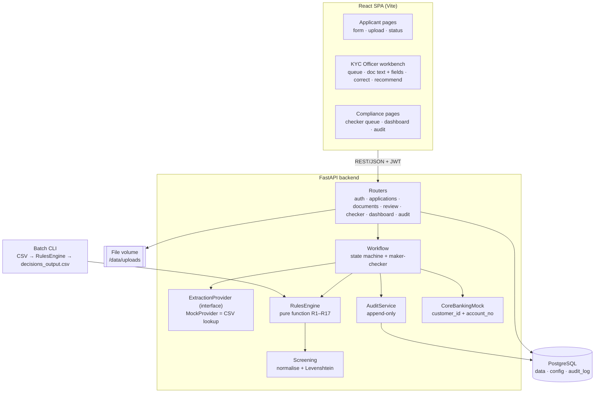
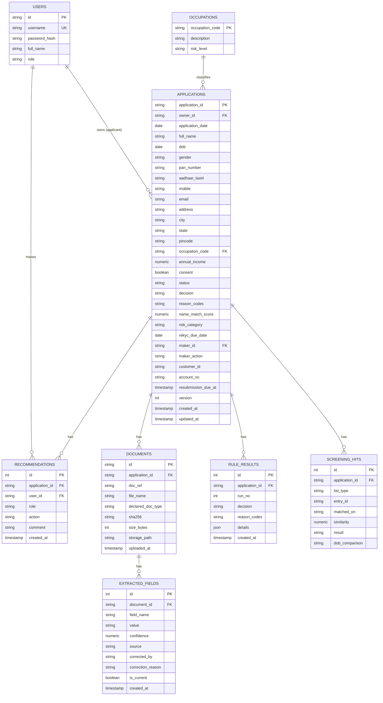
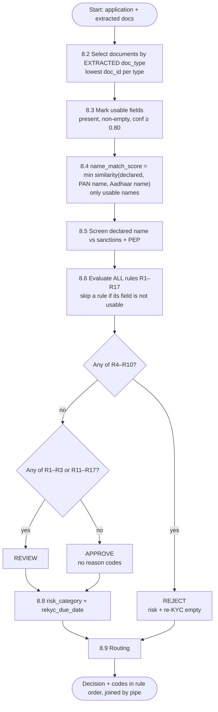
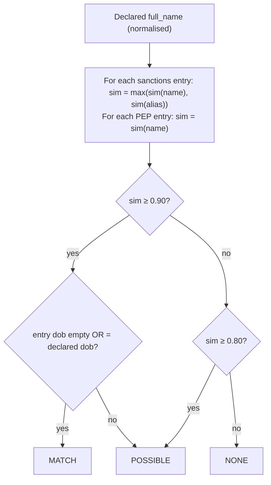
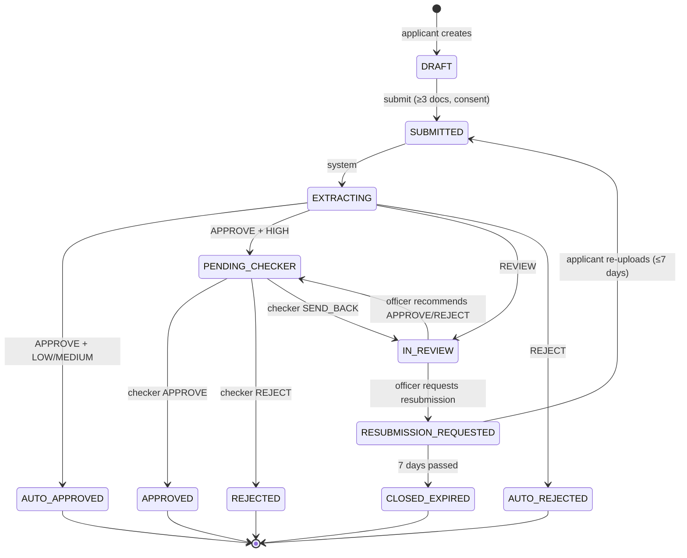
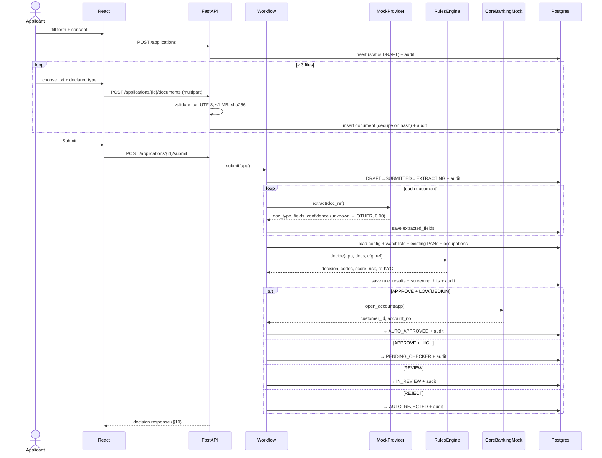
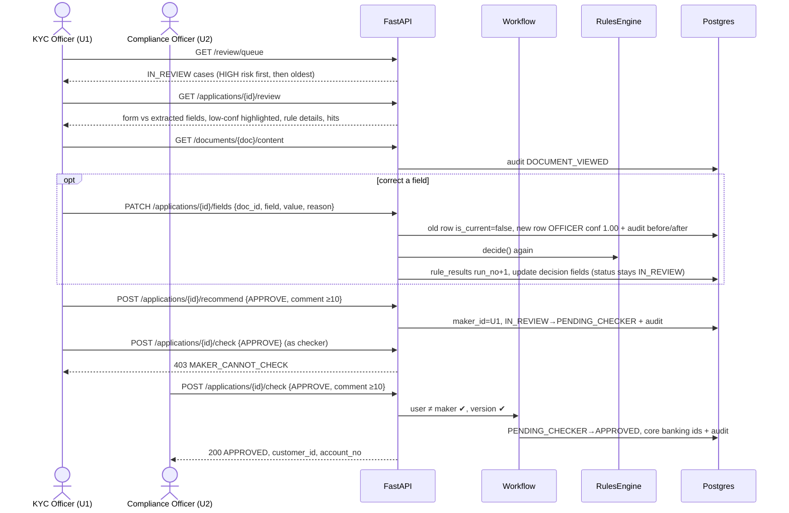
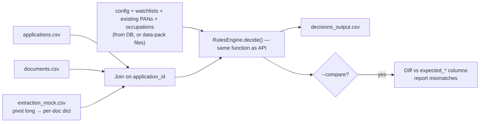
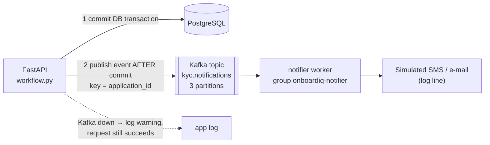

# OnboardIQ — Design Document (Core Track)

**Use case:** 02 OnboardIQ — Intelligent KYC Onboarding, Document Verification and Watchlist Screening with Maker-Checker
**Track:** Full Stack Web Engineer (core only — no AI extractor, no OCR)
**Version:** 1.0 · 23 Oct 2026

> This document is the single source of truth for building the app. Business rules in §8 must be implemented **exactly**; anything we decided ourselves is listed in §20 *Assumptions*. If code and this document disagree, fix one of them and tell the team.

---

## Table of Contents
1. Scope
2. Tech Stack and Environment
3. Architecture
4. Input Data and Seeding
5. Data Model (ER diagram + tables)
6. Configuration
7. Roles and Seeded Users
8. Business Logic (rules engine — exact spec)
9. Workflow and Status Lifecycle
10. API Contract
11. Input Validation
12. Security and Privacy
13. Audit Trail
14. Dashboard Metrics
15. Batch CLI
16. Frontend Screens
17. Folder Structure
18. Testing Plan
19. Build Plan and Definition of Done
20. Assumptions
21. Design Rationale (evaluator talking points)
22. Technology Decisions — Pros, Cons and Alternatives
23. Event-Driven Notifications (Kafka)

---

## 1. Scope

**Build (core):**
- Applicant: register/login, application form, upload ≥3 `.txt` documents, track status, resubmit when asked.
- Mock extraction service behind a pluggable interface (FR-3).
- Rules engine R1–R17 + name matching + sanctions/PEP screening + risk category + re-KYC date (FR-4, FR-5).
- Routing + status lifecycle + maker-checker (FR-7).
- KYC Officer review workbench with field correction (FR-6).
- Compliance Officer checker queue, dashboard (FR-10), audit view.
- Append-only audit trail incl. document views (FR-9).
- Batch command producing `/output/decisions_output.csv` (FR-11).
- Mock core-banking service returning customer ID + account number.
- Docker Compose, seed script, tests.

**Do not build:** AI extractor, OCR / image upload, LLM summary, real UIDAI/NSDL/CKYC, face match, real SMS/e-mail (log line is enough), mobile app.

---

## 2. Tech Stack and Environment

| Layer | Choice | Why |
|---|---|---|
| Backend | Python 3.11, **FastAPI**, Pydantic v2, Uvicorn | Built-in validation (422 with field names) and auto OpenAPI/Swagger (a required deliverable) |
| ORM / DB | SQLAlchemy 2.x + **PostgreSQL 16** | Case requires a real persistent DB; Postgres triggers make the audit log truly append-only |
| Name similarity | **rapidfuzz** (`rapidfuzz.distance.Levenshtein.distance`) | Fast, exact Levenshtein; we compute similarity ourselves per spec |
| Auth | JWT (`pyjwt`) + `bcrypt` | Stateless, role in token claim |
| Uploads | `python-multipart` | FastAPI file upload |
| Batch | `pandas` (CSV I/O only) | Quick CSV read/write; logic still in the shared rules engine |
| Frontend | **React 18 + Vite**, react-router, axios, Recharts | Accepted as main UI (Streamlit is NOT allowed as main UI) |
| Tests | pytest + httpx (FastAPI TestClient) | Rule tests driven by the 60 expected rows |
| Ops | Docker + docker-compose | Required deliverable |

**New dependencies (backend `requirements.txt`):** `fastapi uvicorn[standard] sqlalchemy psycopg[binary] pydantic pyjwt bcrypt python-multipart rapidfuzz pandas confluent-kafka pytest httpx`

**Change (v1.1):** Kafka added for applicant notifications only — see §23. The decision path stays synchronous.

**Environment variables** (never hard-code secrets):

| Variable | Example | Purpose |
|---|---|---|
| `DATABASE_URL` | `postgresql+psycopg://onboard:onboard@db:5432/onboardiq` | DB connection |
| `JWT_SECRET` | *(random string)* | Token signing |
| `JWT_EXPIRE_MINUTES` | `480` | Token lifetime |
| `EXTRACTION_PROVIDER` | `mock` | Selects extraction provider (FR-3) |
| `CORE_BANKING_KEY` | *(random string)* | Service key for mock core-banking |
| `DATA_DIR` | `/data/pack` | Location of the data-pack CSV/JSON files |
| `UPLOAD_DIR` | `/data/uploads` | Uploaded document storage |
| `OUTPUT_DIR` | `/output` | Batch output |
| `KAFKA_ENABLED` | `true` | `false` → events are only logged (tests, laptop without Kafka) |
| `KAFKA_BOOTSTRAP_SERVERS` | `kafka:9092` (compose) / `localhost:29092` (laptop) | Broker address |
| `KAFKA_TOPIC_NOTIFICATIONS` | `kyc.notifications` | Notification topic |

---

## 3. Architecture



### Component responsibilities

| Component | Responsibility | Talks to |
|---|---|---|
| Routers | HTTP, auth dependency, request/response schemas, masking | Services, DB |
| `ExtractionProvider` | `extract(doc) -> ExtractionResult` (doc_type + fields with confidence) | Mock CSV (loaded in DB table `mock_extraction`) |
| `RulesEngine.decide()` | **Pure function**: inputs in, decision out. No DB, no HTTP | Screening |
| `Screening` | Name normalisation, similarity, sanctions/PEP result | — |
| `Workflow` | Runs extract → decide → route; validates every status transition; maker-checker; optimistic locking | Extraction, Rules, Audit, CoreBanking, DB |
| `AuditService` | `log(entity, entity_id, actor, action, from_status, to_status, before, after, comment)` in the **same DB transaction** | DB |
| `CoreBankingMock` | `open_account(application) -> (customer_id, account_no)`; checks `CORE_BANKING_KEY` | — |
| Batch CLI | Reads CSVs, builds the same inputs, calls `decide()`, writes CSV | RulesEngine |

**Processing model:** synchronous. `POST /applications/{id}/submit` runs extraction → rules → routing in one request (mock lookup + rules ≪ 2 s NFR). No queue.

---

## 4. Input Data and Seeding

Data pack files used by the core track (place in `DATA_DIR`):

| File | Rows | Loaded into | Used for |
|---|---|---|---|
| `case_02_rules_config_V1.0.json` | 1 | `config` | All thresholds/patterns/title tokens/re-KYC periods |
| `case_02_occupations_V1.0.csv` | 12 | `occupations` | Risk category |
| `case_02_sanctions_list_V1.0.csv` | 50 | `watchlist_sanctions` | R10 / R15 |
| `case_02_pep_list_V1.0.csv` | 60 | `watchlist_pep` | R16 |
| `case_02_existing_customers_V1.0.csv` | 300 | `existing_customers` | R17 |
| `case_02_extraction_mock_sample_V1.0.csv` (+ `_eval_` later) | 946 | `mock_extraction` | Mock extraction provider |
| `case_02_applications_sample_V1.0.csv` | 60 | `applications` (demo seed) + batch input | Demo data + test oracle |
| `case_02_documents_sample_V1.0.csv` | 178 | `documents` (demo seed) + batch input | Doc ↔ application, `declared_doc_type` |
| `case_02_document_text_sample_V1.0.jsonl` | 178 | files in `UPLOAD_DIR` (demo seed) | Shown to officer; written as `<doc_id>.txt` for the upload demo |

**Not used (AI track only):** `case_02_document_truth_sample_V1.0.csv`.

### Seed command — `python -m app.cli.seed [--with-sample-apps]`
1. Create tables + audit trigger (§13).
2. Load config JSON → `config` (one row per key, value stored as JSON).
3. Load occupations, sanctions, PEP, existing customers, mock extraction (sample; `--eval` flag also loads eval mock).
4. Create seeded users (§7).
5. `--with-sample-apps`: insert the 60 sample applications owned by `applicant_demo`, insert their documents (write each text to `UPLOAD_DIR/<sha256>.txt`), then run the normal submit workflow for each → queues are populated for the demo.
6. Write each document text to `DATA_DIR/upload_demo/<doc_id>.txt` so they can be uploaded through the UI.

`python -m app.cli.reset` drops and re-seeds (idempotent demo reset).

---

## 5. Data Model



Additional tables (no relations drawn): `config(key PK, value JSON)`, `watchlist_sanctions(list_id PK, name, alias, dob, nationality, program)`, `watchlist_pep(pep_id PK, name, dob, position, category)`, `existing_customers(customer_id PK, full_name, pan_number, dob)`, `mock_extraction(doc_id, field_name, value, confidence)` with index on `doc_id`, `audit_log` (§13).

### Notes on key columns
- `applications.application_id`: sample/eval IDs (`A2000001`) for seeded data; new UI applications get `A` + 7-digit sequence starting `A9000001` (no collision with data pack).
- `documents.id`: random **UUID** (unguessable URL). `doc_ref` = file name stem (`D3000001` from `D3000001.txt`) — this is the key the mock provider looks up. Unique constraint `(application_id, sha256)` → idempotent re-upload.
- `extracted_fields`: same long format as the mock CSV. An officer correction **inserts a new row** (`source='OFFICER'`, `confidence=1.00`, `is_current=true`) and sets the old row `is_current=false`. Before/after is therefore never lost.
- `applications.version`: optimistic-locking counter (§9.4).
- `applications.reason_codes`: pipe-joined string, also returned as an array in the API.
- `rule_results`: every rules run is kept (`run_no` 1, 2, …) with `details` JSON (per-rule values compared) for explainability.

---

## 6. Configuration

All thresholds are read from the `config` table at the start of every rules run (one query, passed into `decide()` as a dict). **No thresholds in code.**

Internal keys used by the engine (map them from the actual key names in `case_02_rules_config_V1.0.json` in `config_loader.py`; if the JSON uses different names, only the loader changes):

| Internal key | Default | Used by |
|---|---|---|
| `min_field_confidence` | 0.80 | usable fields, R1, R3 |
| `name_match_pass` | 0.90 | R11 upper bound |
| `name_match_reject` | 0.75 | R9 / R11 lower bound |
| `watchlist_match` | 0.90 | screening |
| `watchlist_possible` | 0.80 | screening |
| `min_age` | 18 | R4 |
| `pan_pattern` | `^[A-Z]{5}[0-9]{4}[A-Z]$` | R5, form validation |
| `pan_holder_char` | `P` (4th char, index 3) | R5 |
| `address_proof_max_age_days` | 90 | R13 |
| `title_tokens` | MR, MRS, MS, MISS, DR, SHRI, SMT, KUMARI | name normalisation |
| `medium_income_threshold` | 2500000 | risk |
| `rekyc_years` | HIGH 2 · MEDIUM 8 · LOW 10 | re-KYC |
| `resubmission_days` | 7 | resubmission expiry |
| `checker_sla_hours` | 24 | dashboard overdue flag |

`PUT /config/{key}` (Compliance Officer) updates a value and writes an audit row with before/after. Demo: change `name_match_pass` → re-run example 4 → decision changes without code change.

---

## 7. Roles and Seeded Users

| Role (`users.role`) | Can do | Cannot do |
|---|---|---|
| `APPLICANT` | Register, login, create/submit own application, upload docs, view own status + plain-language reasons, resubmit | See confidence scores, watchlist details, other applications, officer APIs (→ 403) |
| `KYC_OFFICER` (maker) | REVIEW queue, view doc text + extracted fields, correct fields (with reason), recommend APPROVE / REJECT / REQUEST_RESUBMISSION | Final approval |
| `COMPLIANCE_OFFICER` (checker) | PENDING_CHECKER queue, APPROVE / REJECT / SEND_BACK, dashboard, audit, config + watchlist maintenance | Check a case where they are the maker (→ 403) |

Seeded users (password for all: `Demo@123`, set at seed time, bcrypt-hashed):

| user id | username | role |
|---|---|---|
| U0 | applicant_demo | APPLICANT (owns seeded sample applications) |
| U1 | officer1 | KYC_OFFICER |
| U3 | officer2 | KYC_OFFICER |
| U2 | checker1 | COMPLIANCE_OFFICER |
| U4 | checker2 | COMPLIANCE_OFFICER |

For example 11 (U1 tries to check own case) we additionally seed **U5 `officer_checker`** who holds role `KYC_OFFICER` **and** `COMPLIANCE_OFFICER` (store roles as a comma-separated list or a `user_roles` table). Without a dual-role user, the 403 would be a plain role check, not a maker-checker check. → See assumption A7.

---

## 8. Business Logic — Rules Engine (exact spec)

### 8.0 Signature

```python
# app/services/rules.py — PURE: no DB, no HTTP, no clock (dates come from inputs)
def decide(app: AppInput,            # declared form values + application_date
           docs: list[DocInput],     # doc_ref, declared_doc_type, extraction (doc_type, conf, fields)
           cfg: dict,                # §6
           ref: ReferenceData        # sanctions, pep, existing_pans:set, occupations:dict
          ) -> Decision:             # decision, reason_codes[list], name_match_score|None,
                                     # risk_category|None, rekyc_due_date|None, details{}, hits[]
```

### 8.1 Overall flow



### 8.2 Document selection
- Each uploaded document takes the **`doc_type` returned by the extraction service** (not the declared type).
- For each type, the **selected** document is the one with the **lowest `doc_ref`** (string compare; `D3000001 < D3000025`).
- Selected slots:
  - `PAN` = lowest doc classified `PAN_CARD`
  - `AADHAAR` = lowest doc classified `AADHAAR_CARD`
  - `ADDRESS` = lowest doc among `ELECTRICITY_BILL`, `BANK_STATEMENT`, `DRIVING_LICENCE` (one slot across all three)
- Docs classified `OTHER` are never selected.

### 8.3 Usable fields and required fields
- A field is **usable** iff it exists, value is not empty, and `confidence ≥ min_field_confidence`.
- A **document counts as present for R1** iff it is selected for that slot **and** its `doc_type` confidence ≥ `min_field_confidence` (assumption A1 — verify on the 60 rows).
- **Required fields per type:**

| doc_type | Required fields |
|---|---|
| PAN_CARD | name, dob, pan_number |
| AADHAAR_CARD | name, dob, aadhaar_last4 |
| ELECTRICITY_BILL, BANK_STATEMENT | pincode, document_date |
| DRIVING_LICENCE | pincode, valid_until |

### 8.4 Name normalisation and similarity

```python
def normalise(name: str, titles: set[str]) -> str:
    s = (name or "").upper().replace(".", " ").replace("-", " ")
    s = re.sub(r"[^A-Z ]", "", s)                    # keep A–Z and space only
    tokens = [t for t in s.split() if t not in titles] # split() also collapses spaces
    return " ".join(sorted(tokens))

def similarity(a: str, b: str) -> float:            # inputs already normalised
    if not a and not b:
        return 1.0
    return 1 - Levenshtein.distance(a, b) / max(len(a), len(b))
```

- `name_match_score` = **min** of `similarity(declared, PAN.name)` and `similarity(declared, AADHAAR.name)` over the names that are **usable**. If neither is usable → `None` (empty in output). Store unrounded; round to 4 dp only for output.
- **Check (example 4):** "Ravi Kumar Sharma" → `KUMAR RAVI SHARMA` (17), "Ravi K Sharma" → `K RAVI SHARMA` (13), distance 4 → 1 − 4/17 = **0.7647**.

### 8.5 Watchlist screening



- List result = **MATCH** if any entry is MATCH; else **POSSIBLE** if any entry is POSSIBLE; else **NONE**.
- Store the best hit (highest similarity among entries with that result) in `screening_hits`: `entry_id`, `matched_on` (NAME/ALIAS), `similarity`, `dob_comparison` (`SAME` / `DIFFERENT` / `LIST_DOB_EMPTY`). Shown on the officer screen (FR-5: example 6 → SAN0002, example 7 → PEP0001).
- Empty alias is skipped (not compared as "").

### 8.6 Rules

Dates are calendar dates. **Age** = completed years on `application_date`. All rules are evaluated (no short-circuit); a rule that depends on a non-usable field is **skipped**.

| Rule | Condition (exact) | Outcome | Reason code | Needs |
|---|---|---|---|---|
| R1 | No present (8.3) PAN slot, **or** no present AADHAAR slot, **or** no present ADDRESS slot | REVIEW | `DOCUMENT_MISSING` | — |
| R2 | Any uploaded doc's extracted `doc_type` ≠ its `declared_doc_type` | REVIEW | `DOCUMENT_TYPE_MISMATCH` | — |
| R3 | Any uploaded doc's `doc_type` confidence < 0.80, **or** any required field (8.3) of a **selected** doc is missing/empty/< 0.80 | REVIEW | `LOW_EXTRACTION_CONFIDENCE` | — |
| R4 | Age(declared dob, application_date) < 18 | REJECT | `AGE_BELOW_18` | declared dob |
| R5 | Declared PAN fails `pan_pattern`, **or** 4th char ≠ `P` | REJECT | `PAN_INVALID` | declared PAN |
| R6 | Usable `pan_number` on PAN slot ≠ declared PAN | REJECT | `PAN_MISMATCH` | usable PAN.pan_number |
| R7 | Usable `dob` on PAN slot ≠ declared dob, **or** usable `dob` on AADHAAR slot ≠ declared dob | REJECT | `DOB_MISMATCH` | ≥1 usable dob |
| R8 | Usable `aadhaar_last4` on AADHAAR slot ≠ declared | REJECT | `AADHAAR_MISMATCH` | usable aadhaar_last4 |
| R9 | `name_match_score` < 0.75 | REJECT | `NAME_MISMATCH` | score not None |
| R10 | Sanctions result = MATCH | REJECT | `SANCTIONS_MATCH` | — |
| R11 | 0.75 ≤ `name_match_score` < 0.90 | REVIEW | `NAME_MISMATCH_MINOR` | score not None |
| R12 | ADDRESS slot is `DRIVING_LICENCE` and usable `valid_until` < application_date | REVIEW | `DOCUMENT_EXPIRED` | usable valid_until |
| R13 | ADDRESS slot is `ELECTRICITY_BILL`/`BANK_STATEMENT` and (application_date − document_date > 90 days **or** document_date > application_date) | REVIEW | `ADDRESS_PROOF_STALE` | usable document_date |
| R14 | Usable `pincode` on ADDRESS slot ≠ declared pincode | REVIEW | `ADDRESS_MISMATCH` | usable pincode |
| R15 | Sanctions result = POSSIBLE | REVIEW | `SANCTIONS_POSSIBLE_MATCH` | — |
| R16 | PEP result = MATCH | REVIEW | `PEP_MATCH` | — |
| R17 | Declared PAN exists in `existing_customers.pan_number` | REVIEW | `DUPLICATE_CUSTOMER` | — |

Comparison normalisation: PAN compared upper-case trimmed; dates compared as `date` objects; pincode/aadhaar compared as trimmed strings.

### 8.7 Decision and reason codes
- `REJECT` if any of R4–R10 triggered; else `REVIEW` if any of R1–R3, R11–R17; else `APPROVE`.
- `reason_codes` = **all** triggered codes in **rule order R1→R17**, joined by `|` in CSV, array in API. APPROVE → empty.
- `name_match_score` reported (4 dp) for **every** decision when computable.

### 8.8 Risk category and re-KYC date (APPROVE and REVIEW only; empty for REJECT)

```
if PEP_MATCH or SANCTIONS_POSSIBLE_MATCH triggered or occupation.risk_level == HIGH: HIGH
elif occupation.risk_level == MEDIUM or annual_income >= 2_500_000:                  MEDIUM
else:                                                                                 LOW

rekyc_due_date = application_date + rekyc_years[risk] years
                 (if result would be 29 Feb in a non-leap year → 28 Feb)
```

```python
def add_years(d: date, n: int) -> date:
    try:
        return d.replace(year=d.year + n)
    except ValueError:              # 29 Feb → non-leap year
        return d.replace(year=d.year + n, day=28)
```

### 8.9 Routing (decision → status)

| Decision | Risk | Next status |
|---|---|---|
| APPROVE | LOW / MEDIUM | `AUTO_APPROVED` (+ mock core banking opens account) |
| APPROVE | HIGH | `PENDING_CHECKER` |
| REVIEW | any | `IN_REVIEW` |
| REJECT | — | `AUTO_REJECTED` |

### 8.10 Worked examples (must pass — `tests/test_examples.py`)

| # | App | Expected |
|---|---|---|
| 1 | A2000001 | APPROVE, no codes, 1.0000, LOW, 2036-03-04, AUTO_APPROVED |
| 2 | A2000002 | REJECT, AGE_BELOW_18, 1.0000, risk/re-KYC empty, AUTO_REJECTED |
| 3 | A2000003 | REJECT, PAN_MISMATCH |
| 4 | A2000004 | REVIEW, NAME_MISMATCH_MINOR, 0.7647, LOW, 2036-03-04, IN_REVIEW |
| 5 | A2000005 | REVIEW, ADDRESS_PROOF_STALE, 1.0000, LOW |
| 6 | A2000006 | REJECT, SANCTIONS_MATCH (hit SAN0002) |
| 7 | A2000007 | REVIEW, PEP_MATCH, HIGH, 2028-03-04 (hit PEP0001) |
| 8 | A2000008 | REVIEW, DOCUMENT_MISSING\|DOCUMENT_TYPE_MISMATCH, 1.0000, LOW |
| 9 | A2000009 | REVIEW, LOW_EXTRACTION_CONFIDENCE (PAN_MISMATCH **not** evaluated) |
| 10 | A2000010 | APPROVE, HIGH, 2028-03-04, PENDING_CHECKER |
| 11 | live | U1 recommends APPROVE on #4; U1 checks → 403; U2 approves → APPROVED + customer_id/account_no |
| 12 | live | Officer corrects #9 PAN to ZZTPS9012Y → re-run → APPROVE, no codes; audit has before/after; case goes to checker |

---

## 9. Workflow and Status Lifecycle

### 9.1 State diagram



`DRAFT` is our addition (application created, documents being uploaded) — the case's lifecycle starts at SUBMITTED. Final states: AUTO_APPROVED, APPROVED, REJECTED, AUTO_REJECTED, CLOSED_EXPIRED.

### 9.2 Transition table (enforced in `workflow.py`)

```python
ALLOWED = {
    "DRAFT":                  {"SUBMITTED"},
    "SUBMITTED":              {"EXTRACTING"},
    "EXTRACTING":             {"AUTO_APPROVED", "PENDING_CHECKER", "IN_REVIEW", "AUTO_REJECTED"},
    "IN_REVIEW":              {"PENDING_CHECKER", "RESUBMISSION_REQUESTED"},
    "RESUBMISSION_REQUESTED": {"SUBMITTED", "CLOSED_EXPIRED"},
    "PENDING_CHECKER":        {"APPROVED", "REJECTED", "IN_REVIEW"},
}
def transition(app, to, actor, comment=None):
    if to not in ALLOWED.get(app.status, set()):
        raise ApiError(409, "INVALID_STATUS_TRANSITION", f"{app.status} -> {to} not allowed")
    # conditional UPDATE with version check (9.4) + audit row in same transaction
```

| From → To | Trigger | Who | Endpoint |
|---|---|---|---|
| DRAFT → SUBMITTED → EXTRACTING → (routed) | Submit | Applicant (system continues) | `POST /applications/{id}/submit` |
| IN_REVIEW → PENDING_CHECKER | Recommend APPROVE or REJECT | KYC Officer (becomes **maker**) | `POST /applications/{id}/recommend` |
| IN_REVIEW → RESUBMISSION_REQUESTED | Recommend REQUEST_RESUBMISSION | KYC Officer | same |
| RESUBMISSION_REQUESTED → SUBMITTED → … | Re-upload + submit | Applicant | `POST /applications/{id}/documents` + `/submit` |
| RESUBMISSION_REQUESTED → CLOSED_EXPIRED | `now > resubmission_due_at` | System | lazy check on read + `python -m app.cli.expire` |
| PENDING_CHECKER → APPROVED / REJECTED / IN_REVIEW | Checker decision | Compliance Officer ≠ maker | `POST /applications/{id}/check` |

### 9.3 Sequence — submission (straight-through)



### 9.4 Sequence — review, correction and maker-checker



### 9.5 Concurrency (two officers on the same case → 409)

Every state-changing endpoint does:

```sql
UPDATE applications
   SET status = :to, version = version + 1, updated_at = now(), ...
 WHERE application_id = :id AND status = :from AND version = :expected_version;
-- rowcount == 0  →  HTTP 409 CONFLICT
```

The client sends the `version` it loaded (`If-Match` header or `version` in body). The second concurrent request finds `version` changed → 409.

### 9.6 Resubmission and expiry
- Officer `REQUEST_RESUBMISSION` → `resubmission_due_at = now + 7 days`; applicant sees "Please upload new documents" + reason messages.
- Applicant uploads new docs (old docs kept; selection rule picks lowest `doc_ref` per type — assumption A6: new uploads for a resubmission **replace** previous docs of the same declared type by marking old ones `superseded`).
- Submit again → full extract → decide → route.
- Expiry: on every read of a RESUBMISSION_REQUESTED application and in `python -m app.cli.expire`, if `now > resubmission_due_at` → `CLOSED_EXPIRED`.

---

## 10. API Contract

Base path `/api/v1`. JSON everywhere (except multipart upload). Swagger at `/docs`.

### 10.1 Conventions
- Auth: `Authorization: Bearer <JWT>`; JWT claims `sub` (user id), `roles` (list), `exp`.
- Dates `YYYY-MM-DD`; timestamps ISO-8601 with `+05:30`.
- PAN masked in **list** responses and exports (`ZZKXXXXX4Q` = first 3 + `XXXXX` + last 2). Full PAN only on the detail view for officers and the owner.

### 10.2 Error format (all errors)

```json
{
  "error": {
    "code": "VALIDATION_ERROR",
    "message": "Request has invalid fields",
    "fields": [
      {"field": "aadhaar_last4", "message": "Enter only the last 4 digits of Aadhaar, not the full 12-digit number"}
    ]
  }
}
```

| HTTP | `code` examples | When |
|---|---|---|
| 400 | `BAD_REQUEST`, `INVALID_FILE` | Malformed request, wrong file type/encoding/size |
| 401 | `UNAUTHENTICATED` | Missing/invalid/expired token |
| 403 | `FORBIDDEN`, `MAKER_CANNOT_CHECK` | Wrong role; maker = checker |
| 404 | `NOT_FOUND` | Not found **or not yours** (applicant accessing another's ID → 404, don't leak existence) |
| 409 | `CONFLICT`, `INVALID_STATUS_TRANSITION` | Version mismatch; illegal status move |
| 422 | `VALIDATION_ERROR` | Field validation (Pydantic handler re-shaped into this format) |

### 10.3 Endpoints

| # | Method & path | Role | Purpose |
|---|---|---|---|
| 1 | `POST /auth/register` | public | Create APPLICANT account |
| 2 | `POST /auth/login` | public | → `{access_token, user:{id, username, roles}}` |
| 3 | `GET /auth/me` | any | Current user |
| 4 | `POST /applications` | APPLICANT | Create application (DRAFT) |
| 5 | `GET /applications/mine` | APPLICANT | Own applications |
| 6 | `GET /applications/{id}` | owner / KO / CO | Detail (applicant view hides confidence + watchlist details) |
| 7 | `POST /applications/{id}/documents` | owner | Upload one `.txt` (multipart: `file`, `declared_doc_type`) |
| 8 | `GET /applications/{id}/documents` | owner / KO / CO | Document list |
| 9 | `GET /documents/{doc_id}/content` | owner / KO / CO | Text content — **audited view** |
| 10 | `POST /documents/{doc_id}/extract` | KO / CO / system | FR-3 extraction (long format) |
| 11 | `POST /applications/{id}/submit` | owner | Extract all docs → decide → route |
| 12 | `GET /review/queue` | KO | IN_REVIEW, ordered risk HIGH→MEDIUM→LOW, then `created_at` asc |
| 13 | `GET /applications/{id}/review` | KO / CO | Workbench payload (fields, conf, rule details, hits, history) |
| 14 | `PATCH /applications/{id}/fields` | KO | Correct a field → re-run rules |
| 15 | `POST /applications/{id}/recommend` | KO | APPROVE / REJECT / REQUEST_RESUBMISSION |
| 16 | `GET /checker/queue` | CO | PENDING_CHECKER, oldest first, SLA overdue flag |
| 17 | `POST /applications/{id}/check` | CO (≠ maker) | APPROVE / REJECT / SEND_BACK |
| 18 | `GET /dashboard?from=&to=` | CO | FR-10 metrics |
| 19 | `GET /applications/{id}/audit` | CO | Full ordered history |
| 20 | `GET /applications/{id}/audit/export` | CO | CSV export |
| 21 | `GET /config` · `PUT /config/{key}` | CO | View / change thresholds (audited) |
| 22 | `POST /watchlists/rescreen` | CO | Re-screen open cases (bonus) |
| 23 | `GET /health` | public | Liveness |

### 10.4 Key request / response shapes

**4. Create application**
```json
POST /api/v1/applications
{
  "full_name": "Ravi Kumar Sharma", "dob": "1990-05-15", "gender": "M",
  "pan_number": "ZZKPS1234Q", "aadhaar_last4": "4821",
  "mobile": "9876543210", "email": "ravi@example.com",
  "address": "Flat 12, Lotus Residency, MG Road", "city": "Mumbai", "state": "Maharashtra",
  "pincode": "400001", "occupation_code": "SALARIED_PRIVATE", "annual_income": 900000,
  "consent": true
}
→ 201 {"application_id": "A9000001", "status": "DRAFT", "version": 1}
```
`application_date` = today (IST) set by server; seeded/batch apps use the CSV value.

**7. Upload document** — multipart `file=@D3000001.txt`, `declared_doc_type=PAN_CARD`
```json
→ 201 {"doc_id": "6f1c…uuid", "doc_ref": "D3000001", "declared_doc_type": "PAN_CARD",
       "sha256": "ab12…", "size_bytes": 412, "duplicate": false}
```
Same hash on same application → `200` with existing doc and `"duplicate": true` (no new row).

**10. Extract (FR-3)**
```json
POST /api/v1/documents/{doc_id}/extract
→ 200 {"doc_id": "…", "doc_ref": "D3000001", "provider": "mock",
       "doc_type": "PAN_CARD", "doc_type_confidence": 0.98,
       "fields": [
         {"field_name": "name", "value": "RAVI KUMAR SHARMA", "confidence": 0.95},
         {"field_name": "dob", "value": "1990-05-15", "confidence": 0.97},
         {"field_name": "pan_number", "value": "ZZKPS1234Q", "confidence": 0.96}
       ]}
```
Unknown `doc_ref` → `doc_type: "OTHER", doc_type_confidence: 0.00, fields: []`.

**11. Submit → decision response (Section 6.3 of the case)**
```json
→ 200 {
  "application_id": "A2000004",
  "decision": "REVIEW",
  "reason_codes": ["NAME_MISMATCH_MINOR"],
  "name_match_score": 0.7647,
  "risk_category": "LOW",
  "rekyc_due_date": "2036-03-04",
  "status": "IN_REVIEW",
  "version": 4,
  "documents": [
    {"doc_id": "…", "doc_ref": "D3000010", "doc_type": "PAN_CARD", "confidence": 0.97},
    {"doc_id": "…", "doc_ref": "D3000011", "doc_type": "AADHAAR_CARD", "confidence": 0.98},
    {"doc_id": "…", "doc_ref": "D3000012", "doc_type": "ELECTRICITY_BILL", "confidence": 0.96}
  ],
  "customer_id": null, "account_no": null
}
```
Applicant-facing variant replaces `reason_codes` with `reasons: [{code, message}]` using the plain-language map (§16.4) and omits confidence.

**13. Review payload (workbench)**
```json
{
  "application": { "...form fields...", "status": "IN_REVIEW", "version": 4 },
  "decision": {"decision": "REVIEW", "reason_codes": ["NAME_MISMATCH_MINOR"], "name_match_score": 0.7647,
               "risk_category": "LOW", "rekyc_due_date": "2036-03-04"},
  "rule_details": [
    {"rule": "R11", "code": "NAME_MISMATCH_MINOR", "triggered": true,
     "compared": {"declared": "KUMAR RAVI SHARMA", "pan_name": "K RAVI SHARMA", "pan_similarity": 0.7647,
                  "aadhaar_name": "KUMAR RAVI SHARMA", "aadhaar_similarity": 1.0}},
    {"rule": "R6", "code": "PAN_MISMATCH", "triggered": false, "skipped": false,
     "compared": {"declared": "ZZKPS1234Q", "extracted": "ZZKPS1234Q"}}
  ],
  "documents": [
    {"doc_id": "…", "doc_ref": "D3000010", "declared_doc_type": "PAN_CARD", "doc_type": "PAN_CARD",
     "doc_type_confidence": 0.97, "selected_as": "PAN",
     "fields": [{"field_name": "name", "value": "RAVI K SHARMA", "confidence": 0.95, "usable": true, "source": "MOCK"}]}
  ],
  "screening": {"sanctions": {"result": "NONE"}, "pep": {"result": "NONE"}},
  "recommendations": []
}
```

**14. Correct field**
```json
PATCH /api/v1/applications/A2000009/fields
{"doc_id": "…", "field_name": "pan_number", "value": "ZZTPS9012Y",
 "reason": "Read from document text; OCR misread S as 5 and 0 as O", "version": 4}
→ 200 <review payload with new decision: APPROVE, no codes, status still IN_REVIEW>
```
`reason` required (≥ 10 chars). Allowed only in `IN_REVIEW`.

**15. Recommend**
```json
POST /api/v1/applications/{id}/recommend
{"action": "APPROVE", "comment": "Name variant verified on Aadhaar", "version": 5}
→ 200 {"status": "PENDING_CHECKER", "maker_id": "U1", "version": 6}
```
`action ∈ {APPROVE, REJECT, REQUEST_RESUBMISSION}`, `comment` ≥ 10 chars.

**17. Check**
```json
POST /api/v1/applications/{id}/check
{"action": "APPROVE", "comment": "Verified maker evidence, approving", "version": 6}
→ 200 {"status": "APPROVED", "customer_id": "CUST100001", "account_no": "50100000000001", "version": 7}
→ 403 {"error": {"code": "MAKER_CANNOT_CHECK", "message": "You recommended this case; a different checker must decide"}}
```
`action ∈ {APPROVE, REJECT, SEND_BACK}`. For HIGH-risk auto-approvals (`maker_id` null) any Compliance Officer may check.

**18. Dashboard** → see §14 for the JSON keys.

---

## 11. Input Validation (server-side, Pydantic)

| Field | Rule | Error message |
|---|---|---|
| full_name | required, 2–100 chars | "Full name is required" |
| dob | valid date, not in the future | "Date of birth cannot be in the future" |
| gender | `M`, `F`, `O` (adapt to values in the CSV) | — |
| pan_number | `^[A-Z]{5}[0-9]{4}[A-Z]$` (upper-cased first) | "PAN must look like ABCDE1234F" |
| aadhaar_last4 | `^[0-9]{4}$`; if 12 digits supplied → specific message | "Enter only the last 4 digits of Aadhaar, not the full 12-digit number" |
| mobile | `^[6-9][0-9]{9}$` | "Mobile must be a 10-digit Indian number" |
| email | valid email | — |
| pincode | `^[1-9][0-9]{5}$` | "Pincode must be 6 digits and not start with 0" |
| occupation_code | must exist in `occupations` | "Unknown occupation" |
| annual_income | ≥ 0 | — |
| consent | must be `true` | "Consent to KYC checks is required" |
| upload file | extension `.txt`, decodes as UTF-8, `0 < size ≤ 1 MB` | "Only UTF-8 .txt files up to 1 MB are allowed" |
| declared_doc_type | PAN_CARD / AADHAAR_CARD / ELECTRICITY_BILL / BANK_STATEMENT / DRIVING_LICENCE | — |
| submit | ≥ 3 documents uploaded | "Upload at least 3 documents" |
| comments / reasons | ≥ 10 chars after trim | "Comment must be at least 10 characters" |

Note: R5 (4th char P) is a **rule**, not form validation — a valid-format PAN with 4th char ≠ P is accepted by the form and then REJECTED by the engine with `PAN_INVALID`.

---

## 12. Security and Privacy

| Concern | Implementation |
|---|---|
| Authentication | JWT, bcrypt password hashes, `JWT_SECRET` from env |
| Role checks | FastAPI dependency `require_roles("KYC_OFFICER")` on every router; applicant on officer API → 403 |
| Object-level access | Applicant queries always `WHERE owner_id = current_user.id`; not found or not owner → 404 |
| Maker-checker | `check` endpoint: `if app.maker_id == current_user.id: 403 MAKER_CANNOT_CHECK` |
| Aadhaar | Only last 4 digits accepted/stored; 12-digit input refused |
| PAN masking | Pydantic list/export schemas mask PAN; logs never print full PAN |
| Document files | Stored at `UPLOAD_DIR/<sha256>.txt` (outside DB), served only via authorised endpoint, `Content-Type: text/plain`, never executed; doc IDs are UUIDs |
| Document views | Every `GET /documents/{id}/content` writes `DOCUMENT_VIEWED` audit row (user, role, timestamp, doc_id) |
| Core banking | `CoreBankingMock.open_account()` requires `CORE_BANKING_KEY` from env (internal call only) |
| Applicant view | No confidence scores, no watchlist entry details — SANCTIONS/PEP shown as "Additional verification required" |
| Secrets | Only via env vars / `.env` (gitignored); `.env.example` committed |

---

## 13. Audit Trail

### Table

```sql
CREATE TABLE audit_log (
  id           BIGSERIAL PRIMARY KEY,
  ts           TIMESTAMPTZ NOT NULL DEFAULT now(),
  entity       TEXT NOT NULL,          -- APPLICATION | DOCUMENT | CONFIG | WATCHLIST | USER
  entity_id    TEXT NOT NULL,
  application_id TEXT,                 -- for fast per-application history
  actor_id     TEXT NOT NULL,          -- user id or 'SYSTEM'
  actor_role   TEXT NOT NULL,
  action       TEXT NOT NULL,
  from_status  TEXT,
  to_status    TEXT,
  before       JSONB,
  after        JSONB,
  comment      TEXT
);

-- Append-only enforced by the database, not just the app
CREATE FUNCTION audit_no_change() RETURNS trigger AS $$
BEGIN RAISE EXCEPTION 'audit_log is append-only'; END; $$ LANGUAGE plpgsql;
CREATE TRIGGER audit_no_update BEFORE UPDATE OR DELETE ON audit_log
  FOR EACH ROW EXECUTE FUNCTION audit_no_change();
```

### Actions logged

| Action | When |
|---|---|
| `APPLICATION_CREATED` | create |
| `DOCUMENT_UPLOADED` | upload (incl. sha256) |
| `DOCUMENT_VIEWED` | every content view |
| `EXTRACTION_COMPLETED` | per document (provider, doc_type, confidence) |
| `RULES_EVALUATED` | every rules run (decision, codes, score, run_no) |
| `WATCHLIST_HIT` | sanctions/PEP MATCH or POSSIBLE (entry id, similarity) |
| `STATUS_CHANGED` | every transition (from/to) |
| `FIELD_CORRECTED` | before/after value + reason |
| `RECOMMENDATION_MADE` | officer action + comment |
| `CHECKER_DECISION` | checker action + comment |
| `ACCOUNT_OPENED` | customer_id, account_no |
| `CONFIG_CHANGED` | key, before/after |

Audit rows are written via `AuditService.log()` inside the **same SQLAlchemy session/transaction** as the change. No update/delete endpoint exists.

---

## 14. Dashboard Metrics (Compliance Officer)

Filter: `from`/`to` on `application_date` (default: all). All numbers come from SQL on `applications` / `audit_log` so they reconcile.

| Key | Definition |
|---|---|
| `by_status` | count of applications per status |
| `decided` | applications whose rules decision is not null (i.e. past EXTRACTING) |
| `straight_through_rate` | `AUTO_APPROVED ÷ decided` |
| `review_rate` | rules decision REVIEW ÷ decided |
| `reject_rate` | rules decision REJECT ÷ decided (first run) |
| `top_reason_codes` | top 5 codes by count (split `reason_codes` on `|`) |
| `avg_time_in_review_minutes` | mean of (time leaving IN_REVIEW − time entering IN_REVIEW) from `STATUS_CHANGED` audit rows |
| `pending_checker` | count PENDING_CHECKER; `pending_checker_overdue` = those older than `checker_sla_hours` |

```json
{"by_status": {"AUTO_APPROVED": 21, "IN_REVIEW": 18, "...": 0},
 "decided": 60, "straight_through_rate": 0.35, "review_rate": 0.45, "reject_rate": 0.20,
 "top_reason_codes": [{"code": "NAME_MISMATCH_MINOR", "count": 7}],
 "avg_time_in_review_minutes": 12.4, "pending_checker": 3, "pending_checker_overdue": 0}
```

---

## 15. Batch CLI (FR-11)

```bash
python -m app.cli.batch \
  --applications /data/pack/case_02_applications_sample_V1.0.csv \
  --documents    /data/pack/case_02_documents_sample_V1.0.csv \
  --extraction   /data/pack/case_02_extraction_mock_sample_V1.0.csv \
  --out          /output/decisions_output.csv \
  [--compare]    # sample only: diff against expected_* columns, print mismatches, exit 1 if any
```



**Output** — one row per application, columns **in this order**:

```
application_id,decision,reason_codes,name_match_score,risk_category,rekyc_due_date
A2000001,APPROVE,,1.0000,LOW,2036-03-04
A2000002,REJECT,AGE_BELOW_18,1.0000,,
A2000004,REVIEW,NAME_MISMATCH_MINOR,0.7647,LOW,2036-03-04
```

- `reason_codes` pipe-joined in rule order; empty for APPROVE.
- `name_match_score` 4 dp, empty when not computable.
- `risk_category`, `rekyc_due_date` empty for REJECT.
- Batch does **not** write applications to DB (pure); reads reference data from DB if available, else straight from the data-pack files (`--ref-from-files`) so it runs even without the stack.
- Performance: load everything into memory once; 100 applications ≪ 60 s.
- Hour 5:30: run with the `_eval_` files → submit `/output/decisions_output.csv`.

---

## 16. Frontend Screens

React + Vite SPA, react-router. Route guard by role from `/auth/me`. Axios interceptor adds JWT and shows `error.message` / field errors from §10.2.

### 16.1 Applicant
| Route | Screen | Contents |
|---|---|---|
| `/login`, `/register` | Auth | — |
| `/apply` | Application form | All fields of §11, consent checkbox, inline field errors from 422 |
| `/apply/:id/documents` | Upload | File picker (.txt) + declared-type dropdown per file, list of uploaded docs, Submit (enabled at ≥3) |
| `/my/:id` | Status | Status timeline (from audit), decision in plain language, reasons list, account number if approved, re-upload panel if RESUBMISSION_REQUESTED (with due date) |

### 16.2 KYC Officer
| Route | Screen | Contents |
|---|---|---|
| `/review` | Queue | Table: application, name, risk badge, reason codes, submitted at |
| `/review/:id` | Workbench | **Left:** document tabs showing raw text (each open = audited view). **Right:** declared vs extracted table — usable ✔ / low confidence highlighted red; rule details (values compared, similarity, skipped rules); watchlist hit card (entry id, similarity, dob comparison). **Actions:** "Correct field" modal (field, new value, reason) → shows new decision; Recommend (APPROVE / REJECT / REQUEST_RESUBMISSION + comment) |

### 16.3 Compliance Officer
| Route | Screen | Contents |
|---|---|---|
| `/checker` | Checker queue | PENDING_CHECKER list, maker name, maker comment, age + SLA overdue flag |
| `/checker/:id` | Checker view | Read-only workbench + maker recommendation; APPROVE / REJECT / SEND_BACK + comment; 403 message shown if maker |
| `/dashboard` | Dashboard | KPI tiles (STP rate, review rate, reject rate, pending checker), bar chart by status, top 5 reason codes, date filter (Recharts) |
| `/audit/:id` | Audit | Ordered table of audit rows + "Export CSV" |
| `/config` | Config | Key/value table, edit with confirmation |

### 16.4 Plain-language reason messages (applicant)

| Code | Message |
|---|---|
| DOCUMENT_MISSING | We need your PAN card, Aadhaar card and one address proof. |
| DOCUMENT_TYPE_MISMATCH | One of the documents does not match the type you selected. |
| LOW_EXTRACTION_CONFIDENCE | Part of a document was hard to read; our team will check it. |
| AGE_BELOW_18 | You must be 18 or older to open this account. |
| PAN_INVALID | The PAN entered is not a valid individual PAN. |
| PAN_MISMATCH | The PAN on your PAN card does not match the PAN you entered. |
| DOB_MISMATCH | Your date of birth does not match your documents. |
| AADHAAR_MISMATCH | The Aadhaar digits do not match your Aadhaar card. |
| NAME_MISMATCH | Your name does not match the name on your documents. |
| NAME_MISMATCH_MINOR | Your name differs slightly from your documents; our team will check it. |
| DOCUMENT_EXPIRED | Your driving licence has expired. |
| ADDRESS_PROOF_STALE | Your address proof must be dated within the last 90 days. |
| ADDRESS_MISMATCH | The pincode on your address proof does not match your application. |
| SANCTIONS_MATCH / SANCTIONS_POSSIBLE_MATCH / PEP_MATCH | Additional verification is required. |
| DUPLICATE_CUSTOMER | You may already be our customer; our team will check. |

---

## 17. Folder Structure

```
/code
  docker-compose.yml
  .env.example
  backend/
    Dockerfile
    requirements.txt
    app/
      main.py                 # FastAPI app, routers, error handlers, CORS
      settings.py             # env vars
      db.py                   # engine, session, Base
      models.py               # SQLAlchemy models (§5)
      schemas.py              # Pydantic request/response + masking
      errors.py               # ApiError + handlers → §10.2 format
      auth.py                 # JWT, bcrypt, require_roles, current_user
      routers/
        auth.py applications.py documents.py review.py checker.py dashboard.py audit.py config.py
      services/
        rules.py              # decide() — PURE
        screening.py          # normalise(), similarity(), screen()
        dates.py              # age(), add_years()
        extraction.py         # ExtractionProvider, MockProvider, get_provider()
        workflow.py           # submit(), correct_field(), recommend(), check(), transitions, locking
        audit.py              # AuditService.log()
        core_banking.py       # CoreBankingMock
        reference.py          # load cfg + watchlists + existing PANs + occupations
        config_loader.py      # JSON → config table key mapping
      cli/
        seed.py reset.py batch.py expire.py
    tests/
      test_screening.py       # normalise, 0.7647, empty strings
      test_dates.py           # age boundaries, 29 Feb
      test_rules_sample.py    # all 60 expected rows
      test_examples.py        # worked examples 1–10
      test_api.py             # 403/404/409/422, maker-checker, upload dedupe
  frontend/
    Dockerfile
    package.json  vite.config.js
    src/
      main.jsx App.jsx api.js auth.jsx
      pages/applicant/  ApplyForm.jsx Upload.jsx Status.jsx
      pages/officer/    Queue.jsx Workbench.jsx
      pages/compliance/ CheckerQueue.jsx CheckerView.jsx Dashboard.jsx Audit.jsx Config.jsx
      components/       FieldTable.jsx DocViewer.jsx ReasonList.jsx StatusTimeline.jsx
/output
  decisions_output.csv
  design/  design_document.md  (this file)  er_diagram.png  lifecycle.png
```

`docker-compose.yml` services: `db` (postgres:16, volume), `backend` (depends_on db, mounts `/data/pack`, `/data/uploads`, `/output`, runs seed on start if empty), `frontend` (Vite build served by nginx or `vite preview`, proxies `/api` to backend).

---

## 18. Testing Plan

| Test | What it proves |
|---|---|
| `test_screening.py` | Normalisation (titles dropped, token order ignored, punctuation), example 4 → 0.7647, both-empty → 1.0 |
| `test_dates.py` | Age on birthday / day before; `add_years(2024-02-29, 2)` → 2026-02-28 |
| `test_rules_sample.py` | Run `decide()` on all **60** sample apps from the CSVs; assert decision, reason_codes, name_match_score (4 dp), risk, re-KYC equal expected columns. **This is the main correctness gate.** |
| `test_examples.py` | Examples 1–10 individually with readable names |
| `test_api.py` | 12-digit Aadhaar → 422 with field; applicant on `/review/queue` → 403; applicant reading another's app → 404; no token → 401; maker=checker → 403; stale version → 409; duplicate upload → no new row; config change flips example 4 decision |
| Manual demo script | Examples 11 and 12 end-to-end through the UI |

Run: `docker compose exec backend pytest -q`.

---

## 19. Build Plan and Definition of Done

### Team split (4 people, ~3 hours to working end-to-end)

| Time | P1 — Rules engine | P2 — Backend API | P3 — Frontend | P4 — Data, batch, docs |
|---|---|---|---|---|
| 0:00–0:30 | `screening.py`, `dates.py` + tests | `models.py`, `db.py`, docker-compose, `auth.py` | Vite scaffold, router, login, api.js | `seed.py` (config, ref data, mock extraction, users), `config_loader.py` |
| 0:30–1:30 | `rules.py` R1–R17, risk, re-KYC | applications + documents + extract + submit (`workflow.py`, audit) | Apply form + upload + status pages | `batch.py` + `--compare`; run on 60 rows, report mismatches to P1 |
| 1:30–2:30 | Fix all 60 mismatches; `rule_details` for UI | review queue, correct field, recommend, check (403/409), core banking | Officer workbench + checker screens | Dashboard endpoint, audit endpoints + export |
| 2:30–3:00 | `test_rules_sample.py` green | `test_api.py` | Dashboard + audit pages | ER + lifecycle diagrams exported, README |
| 5:30 | — | — | — | Run batch on eval files → `/output/decisions_output.csv` |

### Definition of Done (map to FRs)

- [ ] FR-1 Roles enforced server-side; 403 applicant→officer API; 404 on other's application
- [ ] FR-2 Form + upload validation; 12-digit Aadhaar refused; sha256 stored; duplicate upload ignored
- [ ] FR-3 `POST /documents/{id}/extract` with `EXTRACTION_PROVIDER=mock`; unknown → OTHER/0.00
- [ ] FR-4 R1–R17 from config; **60/60 sample rows match**; config change flips a decision
- [ ] FR-5 Matched entry + similarity + dob comparison on screen; 0.7647, SAN0002, PEP0001
- [ ] FR-6 Workbench: text beside fields, low-conf highlighted, correction re-runs rules, before/after audited
- [ ] FR-7 Maker-checker; example 10 PENDING_CHECKER; example 11 403 then APPROVED with account number
- [ ] FR-8 Applicant timeline + plain reasons + resubmission within 7 days
- [ ] FR-9 Append-only audit incl. document views; DB trigger blocks update/delete
- [ ] FR-10 Dashboard figures reconcile with data
- [ ] FR-11 Batch CLI writes `decisions_output.csv` in exact column order
- [ ] NFR 409 on concurrent action; masking; rules < 2 s; batch < 60 s
- [ ] Deliverables: design doc, ER diagram, lifecycle diagram, OpenAPI (`/docs`), Dockerfile + compose, seed script, tests

---

## 20. Assumptions (state these to evaluators)

| # | Assumption | Why / how to verify |
|---|---|---|
| A1 | For R1, a slot is "present" if a selected doc exists for it **and** its doc_type confidence ≥ 0.80 | Case does not define a "usable document". Verify on the 60 rows; if mismatches, switch flag `R1_REQUIRE_TYPE_CONFIDENCE=False` (doc only needs to be classified) |
| A2 | Document selection uses the classified type regardless of its confidence | Spec says "each uploaded document takes the doc_type returned"; confidence is handled by R3 |
| A3 | Sanctions similarity per entry = max(sim(name), sim(alias)); empty alias skipped | Spec: "compares … with each list entry's name and alias" |
| A4 | Screening uses the same normalisation as name matching | FR-5 references "the normalisation and Levenshtein similarity of 6.1" |
| A5 | Field correction re-runs rules and updates the decision but keeps status IN_REVIEW; the officer then recommends → PENDING_CHECKER | Spec: "the case still goes to the checker"; example 12's PENDING_CHECKER follows the officer's recommendation |
| A6 | On resubmission, newly uploaded docs supersede earlier docs of the same declared type | Otherwise "lowest doc_id" would keep re-selecting the old bad document |
| A7 | A dual-role user (U5) exists to demonstrate the maker≠checker 403 | Example 11 has the same user acting as officer and checker |
| A8 | DRAFT status added before SUBMITTED | Needed while documents are being uploaded |
| A9 | Applicant gets 404 (not 403) for another applicant's application | Avoids revealing that the ID exists; spec only requires no data exposure |
| A10 | Officer recommendation REJECT also goes to the checker | Lifecycle: IN_REVIEW → PENDING_CHECKER on any recommendation |

---

## 21. Design Rationale (evaluator talking points)

1. **Rules engine is a pure function shared by API and batch** — identical results in both paths, unit-testable against all 60 expected rows without a server or DB. Alternative (rules inside endpoints) would duplicate logic and drift.
2. **Extraction behind an interface (Strategy pattern)** — `EXTRACTION_PROVIDER` switches implementations with no code change (FR-3); an AI/OCR provider can be dropped in later without touching rules.
3. **Config in a DB table** — thresholds change at runtime with an audit row; no redeploy (FR-4). Alternative (constants/env) needs a restart and isn't audited.
4. **Explicit state machine** — one table of allowed transitions; illegal moves → 409. Prevents bugs like approving an AUTO_REJECTED case.
5. **Optimistic locking (`version` column)** — two officers can't both act; second gets 409. Cheaper and simpler than row locks held across user think-time.
6. **Audit append-only at DB level (trigger)** — immutability is guaranteed even if application code has a bug; written in the same transaction so no change exists without its audit row.
7. **Extracted fields stored in long format with `source` + `is_current`** — mirrors the provider output, and corrections are new rows, so before/after history is natural.
8. **Files on disk named by SHA-256, metadata in DB** — keeps DB small, dedupe for free, URLs use UUIDs and require auth; every view audited.
9. **Synchronous processing** — mock extraction + rules is milliseconds; a queue would add failure modes with no benefit. Would move to a worker if real OCR/LLM (10 s/doc) were added.
10. **AI never decides (here: no AI at all)** — low-confidence fields are excluded from identity rules and send the case to REVIEW, so a misread can never auto-reject a genuine customer.

---

## 22. Technology Decisions — Pros, Cons and Alternatives

**Selection criteria (in priority order):** (1) working end-to-end in ~3 hours, (2) team already knows it, (3) meets the case's hard constraints (real DB server, non-Streamlit UI, Docker, OpenAPI), (4) easy to explain in interviews.

| Technology | Why we chose it | Pros | Cons / risks | Alternatives considered |
|---|---|---|---|---|
| **Python 3.11** | Same language for rules, batch CLI and tests; team's strongest for data work | Fast to write; great CSV/date/string libraries; one language end-to-end on the backend | Slower than Java/Go (irrelevant at 100–3,000 apps); dynamic typing → bugs show at runtime (mitigated by Pydantic + tests) | Java (more boilerplate), Node.js (weaker data tooling) |
| **FastAPI** | Validation + Swagger out of the box | Pydantic validation gives 422 with field names automatically (FR-2); auto OpenAPI at `/docs` (required deliverable); dependency injection makes `require_roles` clean; async-capable; very little code | Younger ecosystem than Django; no built-in admin, auth or migrations — we add JWT ourselves | **Django + DRF** (admin panel and auth for free, but heavier, slower to set up); **Flask** (minimal, but manual validation and no auto docs); **Spring Boot** (enterprise standard at banks, but far more boilerplate for 3 hours) |
| **Pydantic v2** | Comes with FastAPI | Declarative validation (regex for PAN, pincode, mobile); same models used for masking in responses; clear error messages | Custom error shape needs one exception handler to reformat 422s | Marshmallow (manual, more code) |
| **PostgreSQL 16** | Case requires a real DB server | ACID transactions → state change + audit row commit together; **triggers** make audit truly append-only; JSONB for rule details/before-after; conditional `UPDATE … WHERE version=` for 409; strong date types | Needs a running server (Docker handles it); schema changes need care (no migrations tool in 3 h — we recreate on reset) | **MySQL** (fine, but weaker JSON + triggers ergonomics); **MongoDB** (flexible docs, but no multi-table transactions by default and relational data here: applications → documents → fields); **SQLite** (not accepted as final DB: not a server) |
| **SQLAlchemy 2.x** | Standard Python ORM | DB-agnostic models; sessions give one transaction per request; raw SQL possible for the optimistic-lock `UPDATE` | Learning curve; easy to write N+1 queries (only matters at scale) | Raw SQL with psycopg (faster to write queries, more manual mapping); SQLModel (nicer with FastAPI, smaller community) |
| **rapidfuzz** | Exact Levenshtein distance | C++ implementation, very fast; `Levenshtein.distance` gives the raw distance we need to compute **our** similarity formula exactly | Its ready-made `ratio()` uses a **different** formula — must not use it, or 0.7647 won't match | python-Levenshtein (similar, less maintained); hand-written DP (~10 lines, O(n·m), fine for short names — good fallback and a good DSA talking point) |
| **JWT (pyjwt) + bcrypt** | Simple stateless auth with role claims | No session store needed; role in token → cheap 403 checks; bcrypt is a slow, salted hash (safe password storage) | Tokens can't be revoked before expiry (acceptable for a demo; mitigate with short expiry); must keep `JWT_SECRET` in env | Server sessions + cookies (revocable, needs storage + CSRF care); OAuth/Keycloak (realistic for banks, overkill for 3 h) |
| **pandas** (batch only) | CSV read/write + pivot of long-format mock file | One-liners for reading, pivoting and writing CSVs | Heavy dependency; floats can sneak in (we format score to 4 dp ourselves and keep logic in plain Python) | Python `csv` module (lighter, more code) |
| **React 18 + Vite** | Accepted main UI; team familiarity | Component reuse (FieldTable, DocViewer used by officer and checker); Vite starts in seconds with hot reload; huge ecosystem | More setup than Streamlit; state management by hand; separate build + CORS/proxy config | **Streamlit/Gradio** (fastest, but **explicitly not accepted** as main UI); Angular (heavier); Next.js (SSR not needed); server-rendered Jinja templates (simple, but clunky for interactive workbench) |
| **react-router + axios** | Standard SPA routing and HTTP | Role-based route guards; axios interceptor adds JWT and handles errors in one place | Two more dependencies | fetch API (built-in, a bit more boilerplate) |
| **Recharts** | Dashboard charts | Declarative React components, 5 minutes to a bar chart | Limited for complex visuals (not needed) | Chart.js, plain HTML tables |
| **pytest + httpx TestClient** | Rule tests from the 60 expected rows + API tests | Parametrised tests over CSV rows; TestClient calls FastAPI without a running server | Need a test DB for API tests (use the compose Postgres or a separate schema) | unittest (more verbose) |
| **Docker + docker-compose** | Required deliverable | One command starts db + backend + frontend identically on every laptop and for evaluators; avoids "works on my machine" | Image builds take time on first run; volume/permission quirks on Windows | Manual setup instructions (fragile, not accepted) |
| **Kafka (KRaft, single broker)** — notifications only (§23) | Event-driven applicant notifications without slowing or coupling the decision path | Decouples "decide" from "notify"; keyed by application_id → per-application ordering; consumer can be scaled/replaced (SMS, e-mail) without touching the API; replayable log | One more container (~500 MB RAM); at-least-once delivery means consumers must dedupe; overkill for one consumer — we keep it **out of the decision path** so a Kafka outage never blocks onboarding | RabbitMQ / Redis Streams (lighter, also fine); in-process queue (simplest, but lost on restart); **no queue in the decision path** — mock extraction + rules take milliseconds |

### One-line answers for "why not X?"
- **Why not Streamlit?** The case forbids it as the main UI; it also can't do proper role-based multi-page workflows well.
- **Why not MongoDB?** Our data is relational (application → documents → fields → audit) and we need transactions so a status change and its audit row commit together.
- **Why not Spring Boot, which banks actually use?** Same architecture would work; in 3 hours FastAPI gives validation and Swagger with far less code. The design (layers, interfaces, state machine) maps 1-to-1 to Spring.
- **Why not microservices?** One team, one day, one domain — a modular monolith with clear service modules (extraction, rules, workflow, audit) gives the same separation without network calls; the extraction interface is where we'd split first.
- **Why not async workers?** Nothing in the core path is slow; synchronous keeps the request → decision flow easy to debug and demo.

---

## 23. Event-Driven Notifications (Kafka)

**Change from v1.0:** Kafka is added **only** for applicant notifications (simulated SMS/e-mail = log line, as the case allows). Decisions, routing and maker-checker remain synchronous in the request.



### Events

| event_type | Published when | payload |
|---|---|---|
| `APPLICATION_SUBMITTED` | after submit commit | `{}` |
| `DECISION_MADE` | after rules + routing commit | `{status, decision}` |
| `RESUBMISSION_REQUESTED` | officer requests resubmission | `{due_date}` |
| `CHECKER_DECISION` | checker APPROVE / REJECT / SEND_BACK | `{status}` |
| `ACCOUNT_OPENED` | mock core banking returns account | `{account_no_masked}` |
| `APPLICATION_EXPIRED` | 7-day resubmission window passed | `{}` |

Envelope: `{event_id (uuid), event_type, occurred_at (IST ISO-8601), key (application_id), payload}`.

### Rules
- **Publish after commit** — never notify about a change that was rolled back. (Production upgrade: transactional outbox table + relay.)
- **Key = application_id** — all events for one application go to the same partition, so they arrive in order.
- **No PII in events** — no PAN, Aadhaar, DOB or names; account number masked.
- **Producer:** `enable.idempotence=true`, `acks=all`; `publish()` never raises — on failure it logs the event.
- **Consumer:** manual offset commit **after** sending; dedupe by `event_id` → at-least-once delivery, effectively-once notification.
- **Kafka outage never blocks onboarding** — backend does not depend on Kafka in docker-compose.

### Files
- `backend/app/events.py` — `EventPublisher`, event type constants, `publisher` singleton.
- `backend/app/workers/notifier.py` — consumer loop, message templates.
- `docker-compose.yml` — `kafka` (apache/kafka 3.8.0, KRaft), `kafka-init` (creates topic), `notifier`.

### Talking points
- "Why Kafka here?" — decouples deciding from notifying; new channels (real SMS, e-mail, analytics) become new consumer groups with zero API changes.
- "Why not in the decision path?" — decisions must be immediate and consistent; a broker outage must not stop account opening.
- "Delivery guarantee?" — at-least-once with idempotent consumer (dedupe on event_id).

---

## 24. Implementation Notes (v1.2 — MVP build)

Changes and decisions made while building against the real data pack. None changes a business rule.

| # | Topic | Decision | Why |
|---|---|---|---|
| I1 | Assumption A1 (R1) | **Resolved:** a slot is present when a document is *classified* as that type, regardless of its doc_type confidence. Low classification confidence is R3's job. | Expected outputs prove it: A2000013 (PAN doc_type 0.70) and A2000047 (Aadhaar 0.72) expect only LOW_EXTRACTION_CONFIDENCE, not DOCUMENT_MISSING. |
| I2 | Config keys | The `config` table uses the **rules_config JSON keys as-is** (`name_match_threshold`, `name_reject_below`, `pan_holder_type_char`, …); no mapping layer. | One less translation to get wrong; the file loads 1-to-1. |
| I3 | Batch reference data | `app.cli.batch` reads config, watchlists, existing customers and occupations **from the data-pack files** (`--set sample|eval` or explicit paths). | Runs anywhere, even without the DB, at Hour 5:30. |
| I4 | Seeding 2-document applications | Seed submits data-pack applications with `enforce_min_documents=False`. | "≥3 uploads" is an upload-screen rule; A2000016/A2000022 have 2 documents and the expected file decides them by R1. |
| I5 | Business date | `BUSINESS_DATE` env (default 2026-03-04 in `.env.example`) is the application_date for new UI applications. | Data-pack bills are dated Feb 2026; with today's date every live demo would be ADDRESS_PROOF_STALE. |
| I6 | Dependencies | `pandas` removed (csv module keeps "0037"-style Aadhaar digits as text). Dev-only: none. | Fewer dependencies, no dtype surprises. |
| I7 | Optimistic locking | SQLAlchemy `version_id_col` on `applications` (every UPDATE carries `WHERE version = …`; StaleDataError → 409) plus the client-supplied `version` check. | Built-in, tested with two concurrent sessions. |
| I8 | Events | `queue_event()` stores events on the DB session; a SQLAlchemy `after_commit` hook publishes them, `after_rollback` drops them. Seeding suppresses events. | Guarantees "publish only after commit" everywhere. |
| I9 | Extra endpoints | `GET /applications/mine`, `GET /reference/occupations`. | Needed by the applicant UI. |
| I10 | Extra columns | `applications.status_changed_at`, `submitted_at`, `source` (UI/SEED); `documents.superseded`; `rule_results.trigger`, `selected`. | Queue ordering, checker SLA, resubmission (A6), explainability. |
| I11 | Rounding | `name_match_score` output uses 4 decimals, half-up, on the unrounded value. | Matches all 60 expected rows. |
| I12 | Applicant view | Watchlist codes are shown to the applicant as one generic "Additional verification is required" reason. | Applicants must not see watchlist details. |

### Verification results
- Batch: **60 / 60** sample rows match all expected columns; evaluation set: 100 rows written (51 APPROVE, 31 REVIEW, 18 REJECT).
- The same 60 applications decided through the real API workflow (seed) also match 60 / 60.
- 48 automated tests pass on SQLite **and** PostgreSQL 16 (rules, screening, dates, API security, maker-checker 403, optimistic-lock 409, correction audit, config change, resubmission, expiry, dashboard, PAN masking).
- Audit trigger verified on PostgreSQL: UPDATE and DELETE on `audit_log` raise "audit_log is append-only".
- UI flows verified in a headless browser: examples 1, 4, 7, 9→12, 10, 11, validation errors, role guards, dashboard, audit, config.

### Change v1.3 — "Sign in as" role dropdown
- `POST /auth/login` accepts optional `role`: `APPLICANT | KYC_OFFICER | COMPLIANCE_OFFICER | KYC_AND_COMPLIANCE`.
- The account must hold every role it signs in as, else **403 ROLE_NOT_ASSIGNED**; unknown value → 422.
- The JWT carries only the chosen role(s); each request uses token roles ∩ current DB roles, so a token can never grant more than the account has.
- Omitting `role` keeps the old behaviour (all roles of the account).
- Why: least privilege per session — a dual-role user acting as KYC Officer cannot reach checker screens in that session.

### Change v1.4 — Branch onboarding mode (`SELF_SERVICE_ONBOARDING`, default false)
- New flow: customer visits the branch → KYC Officer enters the form + uploads scanned documents → submit. The system creates the customer's APPLICANT login with a one-time password (shown once to the officer). Only customers entered by the bank can sign in.
- New endpoints (KYC Officer only): `POST /branch/applications` (form + optional username → application + customer login), `GET /branch/applications`, `GET /branch/applications/{id}`, `POST /branch/applications/{id}/documents`, `POST /branch/applications/{id}/submit`. Public `GET /auth/config` → `{self_service_onboarding}`.
- In branch mode `POST /auth/register` → 403 SELF_REGISTRATION_DISABLED and applicant `POST /applications` → 403 SELF_SERVICE_DISABLED.
- New control: the officer who entered a branch application cannot correct or recommend it (403 DATA_ENTRY_CANNOT_REVIEW) — segregation of duties; derived from the APPLICATION_CREATED audit row, so no schema change.
- `applications.source = "BRANCH"` marks these cases. Rules, routing, maker-checker, audit and batch unchanged. `true` restores the original self-service flow.
